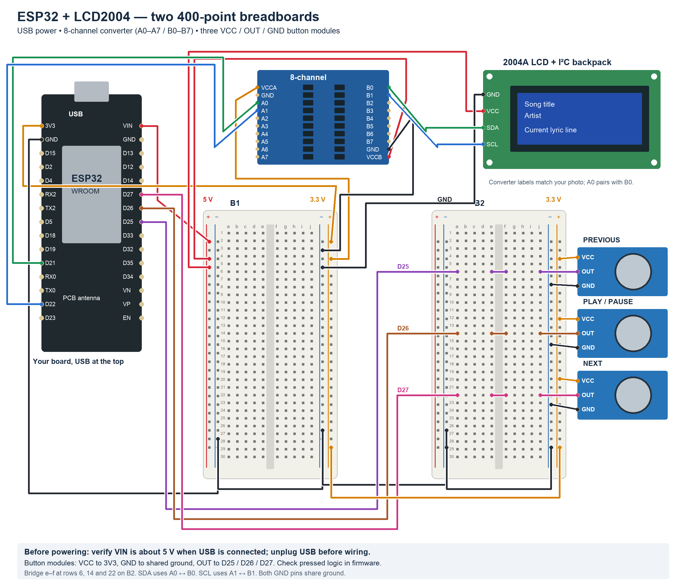
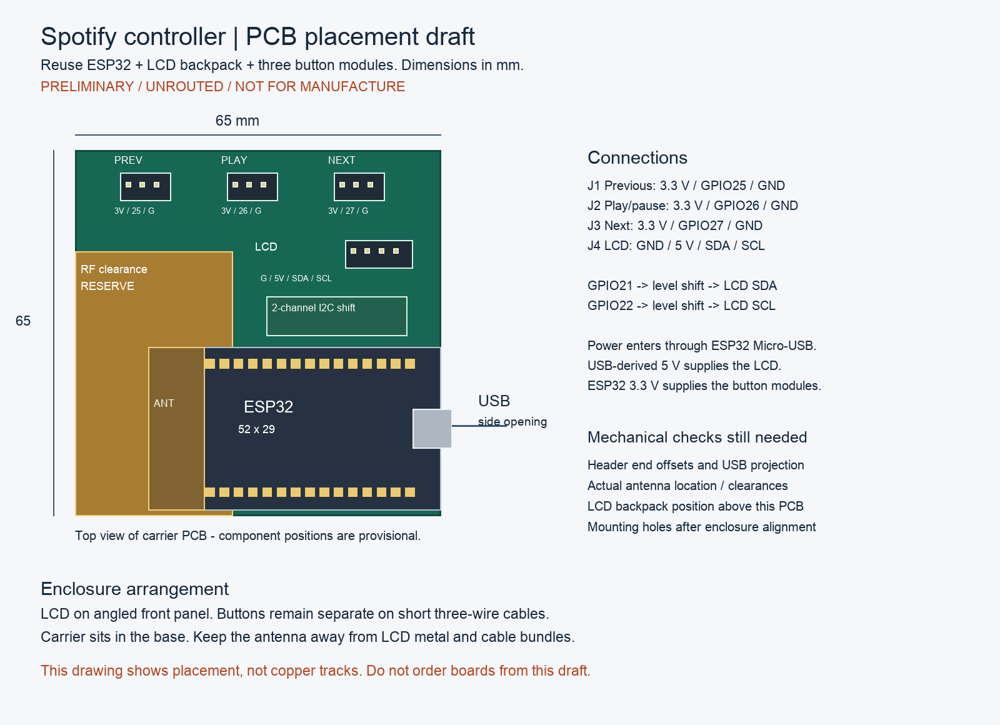

# ESP32 Spotify Lyrics Display

A USB-powered desktop display that shows the current Spotify track and synchronized lyrics on a 20×4 character LCD. Three physical buttons control previous track, play/pause, and next track on an active Spotify player.

The breadboard build is working. The compact PCB and enclosure are still in the planning stage.

## Features

- Track title, artist, and timed lyrics from LRCLIB.
- Previous, play/pause, and next controls through the Spotify Web API.
- Button modules powered from 3.3 V, with startup idle-level calibration.
- Automatic Spotify token refresh and HTTPS certificate verification.
- Background network requests while the display and buttons remain responsive.
- Hardware-test mode and Serial Monitor controls at 115200 baud.

This device controls an existing Spotify player; it does not stream audio itself. Spotify supplies playback information and controls. Lyrics come from LRCLIB.

## Hardware

| Component | Details |
| --- | --- |
| ESP32 | 30-pin ESP32-WROOM-32 development board with CP2102 and Micro-USB |
| Display | LCD2004 / 2004A, 20×4, with PCF8574 I2C backpack |
| Level converter | Bidirectional discrete-transistor 3.3 V ↔ 5 V module; two channels used |
| Buttons | Three VCC / OUT / GND button modules |
| Prototype | Two 400-point breadboards and jumper wires |
| Power | USB through the ESP32 development board |

## Wiring

| Connection | Destination |
| --- | --- |
| ESP32 3V3 | Converter VCCA and all button VCC pins |
| Verified USB-derived 5 V | LCD VCC and converter VCCB |
| GND | Common ground for every module |
| GPIO21 | Converter A0; B0 to LCD SDA |
| GPIO22 | Converter A1; B1 to LCD SCL |
| GPIO25 | Previous button OUT |
| GPIO26 | Play/pause button OUT |
| GPIO27 | Next button OUT |

Verify your development board's USB-derived 5 V pin before connecting the LCD. The pictured converter has no OE pin. Match A0 with B0 and A1 with B1.

## Getting started

See [SETUP.md](SETUP.md) for the complete instructions.

1. Install Arduino IDE, Arduino-ESP32 3.3.x, ArduinoJson 7.x, and the hd44780 library by Bill Perry.
2. Create a Spotify developer app and register `http://127.0.0.1:8888/callback` as its redirect URI. Playback controls require an eligible Spotify Premium account and app access.
3. Run `python3 spotify_login.py` from this repository. It uses Python's standard library and creates your private `SpotifyLyrics/credentials.h`.
4. Open `SpotifyLyrics/SpotifyLyrics.ino`, choose **ESP32 Dev Module**, and select your USB port.
5. Use `HARDWARE_TEST = true` in `config.h` to check the wiring. Set it back to `false` for Spotify mode.
6. Upload, open Serial Monitor at **115200 baud**, and release all buttons during startup calibration.
7. Start playback in Spotify on your phone, computer, or speaker.

For hardware testing before authorization, copy `SpotifyLyrics/credentials.example.h` to `SpotifyLyrics/credentials.h`. Real credentials are required for Spotify mode.

## Credentials

`credentials.h` contains your Wi-Fi password and Spotify refresh token. It is intentionally excluded from this repository by `.gitignore`. Only placeholder values are provided in `credentials.example.h`. Never upload credential files or firmware binaries containing your credentials.

The login helper uses Authorization Code with PKCE and does not require a Spotify client secret.

## PCB and enclosure draft

The proposed carrier starts at 65 × 65 mm and reuses the ESP32, LCD backpack, and button modules. USB faces the side of the enclosure. Two small level-shifting circuits would replace the large converter.

**This is an unrouted placement illustration, not a fabrication-ready PCB.** It has no manufacturing Gerbers. Header-to-board offsets, USB projection, antenna clearance, and mounting details still need verification. See [PCB notes](docs/pcb/README.md) and [editable SVG](docs/pcb/pcb-placement.svg).

## Validation and limitations

- Firmware compiled for ESP32 Dev Module using Arduino-ESP32 3.3.12.
- The builder confirmed working lyrics, physical buttons, playback controls, and action messages.
- Lyrics availability and timing depend on LRCLIB matches and network delays.
- This character LCD displays printable ASCII; unsupported Unicode becomes `?`.
- Spotify developer access, quotas, and service policies can change. See the current provider documentation linked in SETUP.md.
- No audio playback, battery charging, or completed PCB manufacturing design is included.

## References

- [Spotify Web API](https://developer.spotify.com/documentation/web-api)
- [LRCLIB](https://lrclib.net/docs)
- [hd44780 library](https://github.com/duinoWitchery/hd44780)
- [Arduino-ESP32](https://docs.espressif.com/projects/arduino-esp32/en/latest/)

Independent personal project; not affiliated with Spotify or LRCLIB.
